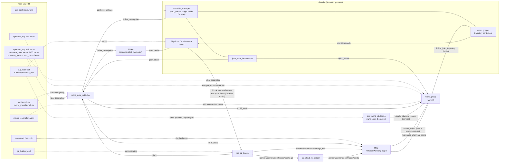

# Cup task workspace: how it fits together

This workspace simulates an **OpenArm v2.0** two-armed robot standing behind a
table with a ceramic cup on it, with an **Intel RealSense D435** depth camera
on a mast above the robot's head. You can watch it in **Gazebo** (the
simulator), look at its camera and joints in **RViz** (the viewer), and plan
collision-free arm motions with **MoveIt** (the motion planner).

Words in *italics* the first time they appear are explained in the
[Glossary](#glossary) at the end.

---

## 1. The big picture

There are two kinds of things in this workspace:

- **Files** you edit: robot descriptions, the world, YAML settings, launch files.
- **Nodes** that run when you launch: small programs that talk to each other
  over *topics*, *services* and *actions*.

The diagram shows which files each node reads (dashed arrows) and which topics
connect the nodes (solid arrows, labelled with the topic name).

Notes on the diagram:

- `/clock` goes to **every** node, not just `robot_state_publisher`. Only one
  arrow is drawn to keep the diagram readable. See *sim time* in the glossary.
- The *controller manager* is not a separate program here: it lives **inside
  Gazebo**, loaded by the `ign_ros2_control` plugin that our URDF asks for.
- Without `moveit:=true`, the MoveIt part (`move_group`, `add_world_obstacles`
  and the MotionPlanning plugin) is not started, and RViz opens with
  `sim.rviz` instead.

---

## 2. The packages

A *package* is a folder ROS knows how to build and find. This workspace has
five. Two more packages it depends on live outside it:
`openarm_description` (OpenArm's official robot model) and
`openarm_bimanual_moveit_config` (OpenArm's official MoveIt settings). We
reuse both without changing them.

### cup_description: what the robot and world look like

Everything that describes *things*: the robot, its camera mast, the table
and the cup. No programs run from here, but launch files read these files.

| File | What it does |
|---|---|
| `urdf/openarm_cup.urdf.xacro` | Main robot description. It builds OpenArm v2.0 from `openarm_description`, chooses Gazebo or real hardware control, and adds the camera mast. Its settings (*xacro args*) include `use_gazebo`, `camera_mast_height`, `camera_forward_offset` and `camera_tilt`. |
| `urdf/camera_mast.xacro` | The mast on the robot's head: clamp plate, upright post, forward bracket and tilting plate, with the D435 screwed on top. |
| `urdf/d435.xacro` | Adds the D435 camera model from `realsense2_description`. In simulation it also adds a Gazebo depth camera sensor, with frame names that match the real camera driver. |
| `urdf/openarm_gazebo.ros2_control.xacro` | Tells *ros2_control* to drive the joints in Gazebo (`IgnitionSystem`) instead of the real motors. It also loads the Gazebo plugin that runs the controller manager. |
| `worlds/cup_table.sdf` | The Gazebo world: ground, light, the table (top surface at 0.75 m), the pedestal the robot stands on, and the cup. |
| `models/ceramic_cup/` | The cup model: a 300 ml mug weighing 0.30 kg. Its visual shape is a mesh; its collision shape is simple boxes and a disc. |
| `cup_description/robot_description.py` | A small Python helper that turns the xacro into the final URDF text. Both launch files use it, so Gazebo, RViz and MoveIt all get the exact same robot. |
| `scripts/mirror_meshes.py` | Runs during the build. OpenArm makes its left arm by mirroring the right arm's shapes, which Gazebo's physics engine can't handle, so this script makes pre-mirrored copies of those shapes. |
| `scripts/generate_cup_mesh.py` | Generates the cup's 3D shape and works out its weight distribution. You only need it if you change the cup's size. |

### cup_bringup: starting the simulation

"Bringup" means "start the whole system". This package holds the main launch
file and the settings for the pieces it starts.

| File | What it does |
|---|---|
| `launch/sim.launch.py` | The one launch file you run. It starts Gazebo, spawns the robot, starts the controllers and the bridge, and optionally MoveIt. |
| `config/sim_controllers.yaml` | Settings for the controllers that move the joints: one trajectory controller per arm, one per gripper, plus the joint state broadcaster. |
| `config/gz_bridge.yaml` | Which Gazebo topics to copy into ROS, and under which names: `/clock` and the camera topics. The names match the real RealSense driver. |
| `scripts/gz_cloud_to_optical.py` | A small node that rotates Gazebo's point cloud into the axis convention the real camera uses (see *optical frame*). |
| `rviz/sim.rviz` | RViz layout without MoveIt: robot model, point cloud and camera image. |

### cup_moveit_config: motion planning

Settings and launch files for MoveIt. Most of it reuses OpenArm's official
MoveIt config; only what differs for our robot lives here.

| File | What it does |
|---|---|
| `launch/move_group.launch.py` | Starts MoveIt's planner (`move_group`), the obstacle loader and RViz with the MotionPlanning plugin. `sim.launch.py` starts it for you when `moveit:=true`. |
| `config/openarm_cup.srdf.xacro` | The *SRDF*. It includes OpenArm's own SRDF (arm groups such as `right_arm`, named poses such as `home`) and adds rules for our camera mast. |
| `config/moveit_controllers.yaml` | Tells MoveIt which controller moves which joints. It differs from OpenArm's version for the grippers, which here use trajectory controllers. |
| `scripts/add_world_obstacles.py` | Reads the world file and adds the table, pedestal and cup to MoveIt's *planning scene*, so plans avoid them. It runs once and exits. |
| `config/moveit.rviz` | RViz layout with the MotionPlanning panel, set to plan for `right_arm`, plus the camera displays. |

Reused from `openarm_bimanual_moveit_config` (not copied):
`kinematics.yaml` (how to compute arm angles for a hand position) and
`joint_limits.yaml` (joint speed limits).

### cup_perception: (empty for now)

A placeholder for the code that will find the cup in the camera's point cloud.

### cup_task: (empty for now)

A placeholder for the code that will run the task itself, for example
"find cup → move above it → grasp".

---

## 3. What happens when I run `ros2 launch cup_bringup sim.launch.py moveit:=true`

In order:

1. **ROS reads the launch file.** `sim.launch.py` collects its arguments
   (`moveit:=true`, plus defaults such as `camera_mast_height:=0.30`).

2. **Gazebo starts** with `worlds/cup_table.sdf`: ground, table, pedestal and
   cup appear. On WSL it uses software rendering, because the WSL graphics
   driver is too old for Gazebo's renderer. The launch file also tells Gazebo
   where to find the meshes for OpenArm, the D435 and the cup.

3. **The robot description is built.** The xacro files become one URDF:
   OpenArm, the mast and the D435, with Gazebo-flavoured control.

4. **`robot_state_publisher` starts.** It publishes the URDF on
   `/robot_description`. It also listens to `/joint_states` and publishes
   where every part of the robot is on `/tf`.

5. **`ros_gz_bridge` starts.** It copies `/clock` and the camera topics from
   Gazebo into ROS, following `gz_bridge.yaml`.

6. **`gz_cloud_to_optical` starts.** It waits for the raw point cloud and
   republishes it as `/camera/camera/depth/color/points`.

7. **The robot is spawned.** The `create` tool reads `/robot_description`,
   puts the robot on the pedestal (0.40 m up), and exits.

8. **The controller manager wakes up inside Gazebo.** The robot's URDF asks
   for the `ign_ros2_control` plugin, so Gazebo loads it. The plugin reads
   `sim_controllers.yaml` and gets ready to drive 16 joints (7 per arm + 1
   per gripper), plus the second finger of each gripper, which copies the
   first.

9. **`joint_state_broadcaster` is started** (it starts once `create` has
   finished). From now on `/joint_states` reports every joint angle, and
   RViz can draw the arms in the right pose.

10. **The four movement controllers are started** (once step 9 is done):
    left and right arm, left and right gripper. They wait for motion
    commands.

11. **MoveIt starts** (once step 10 is done; this is what `moveit:=true`
    adds). `move_group` loads the URDF, the SRDF, kinematics, joint limits
    and the controller list, then prints **"You can start planning now!"**

12. **The obstacles are added.** `add_world_obstacles` reads the table,
    pedestal and cup from the world file and hands them to `move_group`. It
    prints **"Planning scene updated"** and exits.

13. **RViz opens** with `moveit.rviz`: the robot, a draggable marker on the
    right hand, the obstacles in green, the point cloud and the camera image.

14. **You plan and execute.** You drag the marker, click **Plan**, then
    **Execute**. RViz sends the goal to `move_group`. MoveIt finds a
    collision-free path and sends it to `right_joint_trajectory_controller`,
    which moves the joints in Gazebo. The new joint angles flow back through
    `/joint_states`, so RViz shows the arm moving.

Closing the Gazebo window stops everything.

---

## 4. Glossary

**Action**: A request that takes time and reports progress, such as "follow
this trajectory". Like a service, but long-running and cancellable. MoveIt
sends `follow_joint_trajectory` actions to the controllers.

**Bridge (ros_gz_bridge)**: Gazebo has its own messaging system, separate
from ROS. The bridge copies chosen messages between the two, e.g. Gazebo's
camera image becomes the ROS topic `/camera/camera/color/image_raw`.

**Collision object**: A shape (box, cylinder…) in MoveIt's planning scene
that the robot must not touch, e.g. the table.

**Controller**: Code that moves joints. A *trajectory controller* takes a
list of "be at these angles at this time" points and drives the joints
through them.

**Controller manager**: Loads, starts and stops controllers, and runs them
many times a second. Here it runs inside Gazebo.

**Frame**: A named coordinate system attached to something, e.g. `world`
(the robot's base on the pedestal), `openarm_right_ee_base_link` (the right
wrist) or `camera_color_optical_frame` (the camera lens).

**Gazebo**: The physics simulator. It simulates gravity, contacts, motors
and the camera, so the robot behaves roughly like the real one.

**Joint state**: The current angle (and speed and effort) of each joint,
published on `/joint_states`.

**Joint state broadcaster**: A special "controller" that moves nothing; it
just publishes `/joint_states`.

**Kinematics / IK**: Kinematics is the maths linking joint angles to hand
position. *Inverse kinematics* (IK) goes the other way: "which joint angles
put the hand here?" MoveIt uses IK when you drag the marker.

**Launch file**: A Python script that starts many nodes at once with the
right settings, so you don't have to start each one by hand.

**Mesh**: A 3D shape made of triangles (`.stl`, `.dae` files). Used for how
robot parts look and, sometimes, for collisions.

**Mimic joint**: A joint that copies another. The second gripper finger
mimics the first, so one command closes both.

**MoveIt / move_group**: MoveIt is the motion-planning framework.
`move_group` is its main node: it plans paths that avoid collisions and
sends them to the controllers.

**MotionPlanning plugin**: The MoveIt panel inside RViz, with the draggable
marker and the Plan and Execute buttons.

**Node**: One running program in a ROS system, e.g. `robot_state_publisher`
or `move_group`.

**Optical frame**: Cameras use a different axis convention from robots:
z points out of the lens, x right, y down. The `*_optical_frame` frames
follow that convention.

**Package**: A folder with a `package.xml` that ROS can build and find by
name, e.g. `cup_bringup`.

**Parameter**: A setting given to a node when it starts, e.g.
`use_sim_time: true`.

**Planning group**: A named set of joints MoveIt plans for together, e.g.
`right_arm` (7 joints) or `right_gripper`.

**Planning scene**: MoveIt's picture of the world: the robot's current
pose plus all collision objects. Plans are checked against it.

**Point cloud**: A list of 3D points measured by the depth camera, each with
a colour. In RViz it looks like a coloured 3D snapshot of the table and cup.

**ros2_control**: The ROS framework connecting controllers to hardware. The
same controllers can drive real motors or Gazebo; only the hardware plugin
named in the URDF changes.

**RViz**: The 3D viewer. It shows what ROS knows (robot pose, TF frames,
point clouds, plans), not the simulation itself.

**SDF**: Gazebo's file format for worlds and models (`cup_table.sdf`,
`model.sdf`).

**Service**: A quick request/response call between nodes, e.g. "add these
obstacles" (`/apply_planning_scene`).

**Sim time / use_sim_time / /clock**: Gazebo may run slower than real time
(about a third of real speed here). Gazebo publishes its own time on
`/clock`, and every node started with `use_sim_time: true` follows that
clock instead of the computer's, so timings stay consistent.

**Spawn**: Put a robot or object into a running Gazebo world.

**SRDF**: "Semantic" robot description for MoveIt: which joints form an
arm, named poses such as `home`, and which robot parts may touch each other
without counting as a collision.

**TF (/tf, /tf_static)**: The system that tracks where every frame is
relative to every other frame, over time. `robot_state_publisher` publishes
it from the URDF and `/joint_states`. That's how RViz can draw the point
cloud in the right place relative to the robot.

**Topic**: A named channel that one node publishes messages on and others
subscribe to, like `/joint_states`. Many-to-many, one-way, continuous.

**URDF**: An XML file describing a robot: its links (rigid parts with shape
and mass) and joints (how the links move relative to each other).

**Xacro / xacro args**: A tool that builds URDF from smaller files with
variables and reusable blocks (macros). *Xacro args* are the variables you
can set from outside, e.g. `camera_mast_height:=0.12`.
